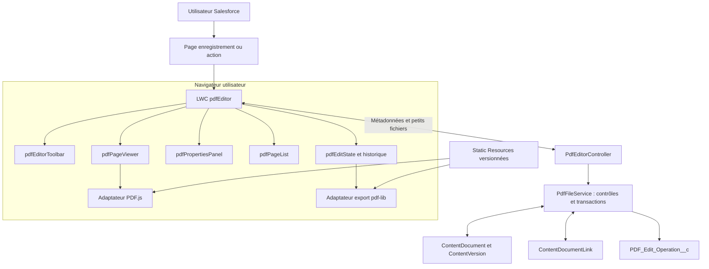
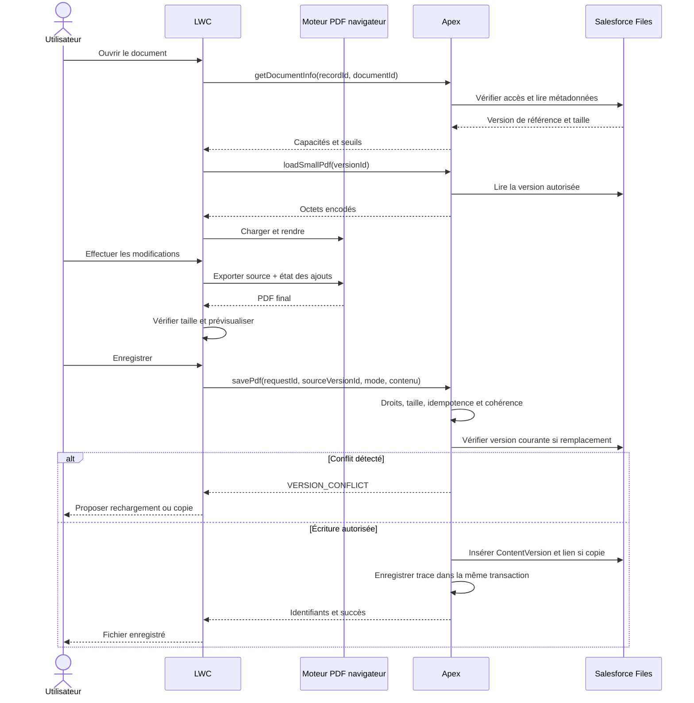
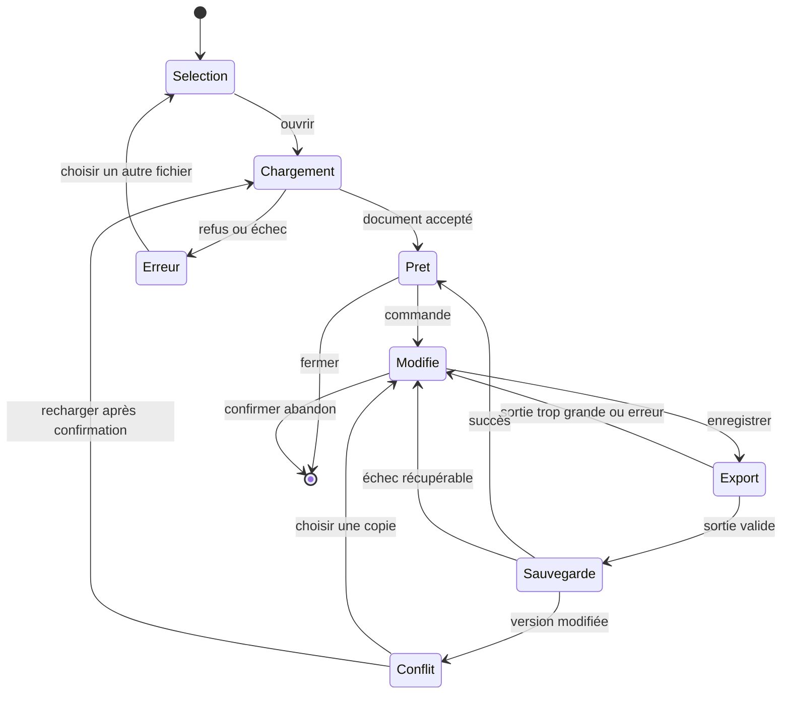
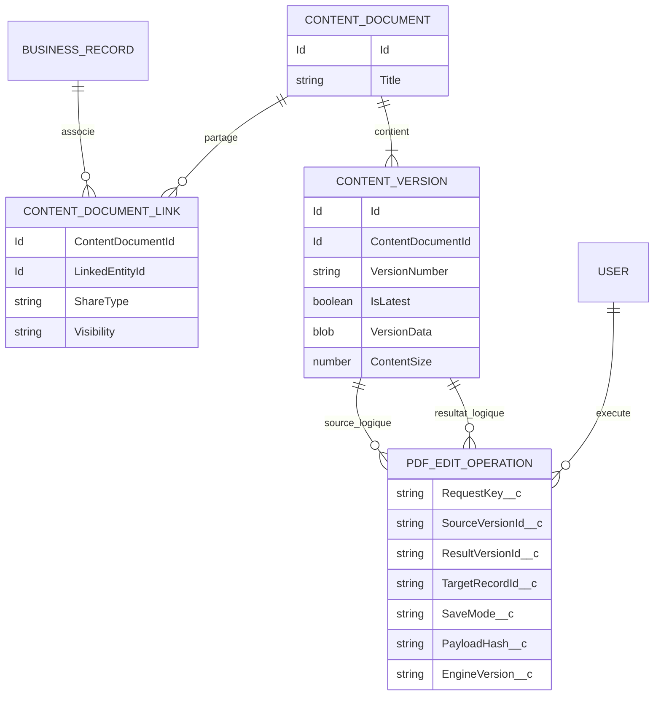

# Étude de faisabilité et modélisation — Éditeur PDF dans Salesforce

**Projet :** LovePdfSales  
**Date :** 13 octobre 2026  
**Statut :** étude documentaire et proposition de conception ; faisabilité en organisation à valider par un prototype.  
**Objectif :** modifier un PDF depuis Salesforce, avec une expérience inspirée d’iLovePDF : ajout de texte, images, suppression et outils complémentaires.

## 1. Décision recommandée

**Oui, un éditeur PDF intégré à Salesforce est réalisable.** Un LWC peut porter l’interface et piloter un moteur PDF exécuté dans le navigateur. Apex assure les accès aux fichiers et l’enregistrement dans Salesforce Files.

Deux périmètres doivent être distingués :

| Besoin | Conclusion | Orientation |
|---|---|---|
| Ajouter du texte, des images et des formes ; supprimer ses ajouts ; gérer les pages | Faisable avec développement spécifique | LWC + PDF.js + pdf-lib, après validation LWS et transport des fichiers |
| Modifier librement le texte d’origine ou effacer définitivement une information | Faisable avec un moteur spécialisé, sous réserve des documents et modules retenus | Évaluer un SDK commercial intégré, en priorité une solution disposant d’une intégration Salesforce documentée |
| Reproduire toute la suite iLovePDF, dont OCR et conversions Office | Projet beaucoup plus large | Lots séparés, SDK ou services spécialisés |

**Recommandation :** commencer par un prototype de 5 à 8 jours-personnes. Si « effacer » signifie retirer définitivement du texte ou une image d’origine, tester immédiatement un SDK comme Apryse WebViewer. Si le besoin principal est d’enrichir des PDF, retenir un premier produit sans service de traitement externe.

Le guide iLoveAPI décrit lui-même l’édition comme l’ajout d’éléments, notamment texte et images ; cette référence ne prouve pas une capacité générale à réécrire le texte d’origine. [Guide officiel iLoveAPI](https://www.iloveapi.com/docs/pdf-guides/edit-api).

Les architectures, seuils, charges et critères ci-dessous sont des **propositions de cette étude**, pas des garanties des éditeurs.

## 2. Contexte et hypothèses

### 2.1 État du projet inspecté

- Le dossier contient un socle Salesforce DX nommé `LovePdfSales`.
- `sfdx-project.json` désigne `force-app` comme répertoire de package et l’API `67.0`.
- La configuration de scratch org indique une édition Developer.
- Aucun composant métier LWC, classe Apex ou moteur PDF n’a été identifié parmi les fichiers du projet inspectés.
- Aucune connexion, inspection de configuration ou exécution de test dans une organisation Salesforce n’a été effectuée pour cette étude.

### 2.2 Hypothèses de travail

| Sujet | Hypothèse initiale |
|---|---|
| Utilisateurs | Collaborateurs Salesforce authentifiés |
| Point d’entrée | Page d’enregistrement, par exemple Opportunity, Account, Case ou objet métier |
| Support initial | Lightning Experience sur ordinateur ; Chrome et Edge à qualifier |
| Fichiers | PDF déjà dans Salesforce Files ou importés depuis le poste |
| Traitement du MVP | Dans le navigateur, sans API PDF externe |
| Conservation | Original conservé ; copie modifiée proposée par défaut |
| Collaboration | Un éditeur par session ; pas de coédition temps réel |
| Langues | Français et caractères latins ; autres écritures à qualifier |

L’expression « directement Salesforce » signifie ici que l’utilisateur reste dans son interface et retrouve ses fichiers dans Salesforce. Elle n’impose pas que les calculs PDF soient réalisés par Apex. Une bibliothèque JavaScript tierce peut être hébergée dans l’organisation et s’exécuter localement dans le navigateur.

## 3. Faisabilité fonctionnelle

**MVP** : première version utilisable. **V2** : extension après validation du MVP.

| Fonction | Faisabilité avec la solution ouverte proposée | Lot / limite |
|---|---|---|
| Afficher, zoomer et parcourir le PDF | PDF.js pour le rendu | MVP |
| Ajouter du texte | Dessin de nouveaux éléments texte | MVP ; police, taille, couleur, position |
| Ajouter une image | Incorporation PNG/JPEG | MVP ; déplacement et redimensionnement |
| Ajouter rectangle, trait, surlignage visuel | Dessin sur la page | MVP ; pas de promesse d’annotation PDF interactive |
| Déplacer, modifier et supprimer ses ajouts | Gestion des objets de la session | MVP avant fermeture de la session |
| Annuler / rétablir | Historique de commandes applicatif | MVP |
| Masquer une zone | Rectangle opaque | MVP ; bouton nommé « Masquer visuellement » |
| Effacer du contenu d’origine de façon irréversible | Pas fourni par la combinaison de base | SDK spécialisé ; lot distinct |
| Modifier une phrase d’origine | Pas d’API générale adaptée dans pdf-lib | SDK spécialisé ; fidélité à tester |
| Rotation et suppression de pages | Manipulation des pages | MVP ; garder au moins une page |
| Réordonner des pages | Réorganisation du document | MVP ; vérifier annotations et liens |
| Fusionner / extraire des pages | Possible par copie de pages | V2 ; budget mémoire cumulé |
| Ajouter filigrane, tampon ou numérotation | Génération d’éléments répétés | V2 |
| Insérer une signature manuscrite en image | Même mécanisme qu’une image | V2 ; ne constitue pas une signature cryptographique |
| Remplir des formulaires AcroForm | Support possible | V2 ; exclure XFA du périmètre initial |
| OCR de scans | Moteur OCR supplémentaire | Hors MVP |
| Compression forte | Réécriture simple insuffisante pour la garantir | Hors MVP ; moteur spécialisé |
| Conversion Word/Excel vers PDF | Moteur de conversion supplémentaire | Hors MVP |
| PDF chiffrés ou protégés par mot de passe | Non retenus avec pdf-lib | Refus explicite dans le MVP |
| PDF avec signature numérique | Risque d’invalidation lors de la réécriture | Refus d’édition dans le MVP |
| Réouvrir un PDF et retrouver les ajouts éditables | Nécessite le projet d’édition conservé séparément | V2, voir § 8.3 |

Références techniques : [rendu PDF.js](https://mozilla.github.io/pdf.js/), [dessin sur PDFPage](https://pdf-lib.js.org/docs/api/classes/pdfpage), [manipulation PDFDocument](https://pdf-lib.js.org/docs/api/classes/pdfdocument), [limites et chiffrement de pdf-lib](https://github.com/Hopding/pdf-lib#limitations).

### 3.1 Définir précisément « effacer »

1. **Supprimer un ajout de la session** : retirer l’objet du modèle avant génération ; comportement attendu d’un éditeur.
2. **Masquer visuellement** : dessiner un rectangle opaque. Le contenu sous-jacent peut rester sélectionnable, extractible ou récupérable.
3. **Caviarder définitivement** : supprimer les contenus concernés, y compris les informations cachées pertinentes ; nécessite un moteur approprié et une validation de la sortie.

Le masquage visuel ne doit jamais être présenté comme un outil de confidentialité. Une gomme dessinée sur un canvas ne supprime pas automatiquement les objets du PDF source. Un recadrage ou la suppression d’une page ne constitue pas non plus une procédure complète d’assainissement du fichier.

Apryse documente une intégration de caviardage dans Salesforce ; cela justifie son évaluation, sans remplacer les tests sur le corpus réel. [Caviardage Salesforce avec WebViewer](https://apryse.com/blog/webviewer/secure-redaction-salesforce-webviewer).

**Attention au versionnement :** même un fichier correctement caviardé ne supprime pas ses versions antérieures dans Salesforce. Un livrable destiné à être diffusé doit être créé comme document distinct, avec des droits adaptés. Le traitement des originaux, historiques, pièces jointes et sauvegardes relève d’une politique de conservation séparée.

## 4. Comparaison des architectures

| Critère | A — LWC + PDF.js + pdf-lib | B — LWC + SDK commercial | C — LWC + API PDF externe |
|---|---|---|---|
| Usage | Ajouts, masquage et organisation | Édition avancée et caviardage | Traitements tels qu’OCR et conversion |
| Interface | À développer | UI du SDK à intégrer et adapter | UI à développer, sauf offre distincte |
| Traitement | Navigateur | Navigateur ou serveur selon modules | Infrastructure du fournisseur |
| Envoi du document à un prestataire | Aucun prévu | À vérifier pour chaque module et configuration | Oui |
| Dépendances | Bibliothèques et maintenance interne | Licence et dépendance fournisseur | Abonnement, réseau et intégration |
| Risque principal | Compatibilité LWS, fidélité et transport | Licence, packaging, compatibilité et transport | Confidentialité, latence, coûts et transport |
| Gros fichiers | Transport Salesforce à résoudre | Le SDK ne résout pas seul le transport | Nécessite aussi un transport adapté |
| Conclusion | Choix recommandé pour le MVP d’enrichissement | Choix recommandé si édition d’origine obligatoire | Extension ciblée |

PDF.js est sous licence Apache 2.0 et pdf-lib sous MIT ; prévoir conservation des notices, inventaire des dépendances et revue des licences des polices. [Licence PDF.js](https://mozilla.github.io/pdf.js/), [licence pdf-lib](https://github.com/Hopding/pdf-lib#license).

Apryse propose une procédure de packaging Salesforce et une intégration LWC, notamment via iframe. Les modules d’édition et de caviardage doivent être explicitement inclus dans l’offre évaluée. Aucun tarif commercial n’est présumé dans cette étude. [Intégration et packaging Apryse](https://apryse.com/blog/webviewer/docx-and-pdf-editing-in-salesforce).

iLoveAPI expose des opérations d’édition, OCR, compression et conversion. Son API de traitement ne remplace pas l’interface interactive à construire. [Catalogue officiel iLoveAPI](https://www.iloveapi.com/products/pdf-rest-api).

## 5. Contraintes Salesforce et techniques

### 5.1 Chargement des bibliothèques et sécurité du navigateur

Les bibliothèques tierces doivent être embarquées en Static Resources et chargées par les mécanismes Salesforce. Une Trusted URL n’autorise pas à charger arbitrairement du JavaScript depuis un CDN. [CSP Salesforce](https://developer.salesforce.com/docs/platform/lightning-components-security/guide/content-security-policy-intro.html), [platformResourceLoader](https://developer.salesforce.com/docs/platform/lightning-component-reference/guide/lightning-platform-resource-loader.html).

Une ressource statique est limitée à 5 MB ; le total documenté par organisation est de 250 MB. Répartir les moteurs, polices et ressources auxiliaires en archives distinctes si nécessaire. [Static Resources](https://developer.salesforce.com/docs/platform/lwc/guide/create-resources.html).

La compatibilité JavaScript navigateur ne garantit pas la compatibilité LWS. Utiliser un conteneur appartenant au LWC et, seulement si nécessaire, `lwc:dom="manual"`. [Bibliothèques tierces dans LWC](https://developer.salesforce.com/docs/platform/lwc/guide/js-third-party-library.html).

**Points bloquants à tester dans le prototype :**

- Distribution PDF.js retenue : modules ES, éventuel bundle adapté, résolution des ressources et polices.
- Création du worker, CSP et chemins des ressources dans l’organisation cible.
- Correspondance exacte entre version du moteur PDF.js et de son worker.
- Interactions canvas, téléchargement du résultat et cycle de destruction du composant.
- Absence de nécessité de désactiver LWS ou d’assouplir globalement la sécurité.

PDF.js distribue un moteur et un worker distincts ; figer les versions et reproduire le build. Si le fonctionnement direct en LWC échoue, étudier une page Visualforce contenant l’éditeur, intégrée dans un LWC par iframe. Cette variante exige une nouvelle qualification et n’est pas une compatibilité acquise. [Distribution PDF.js](https://mozilla.github.io/pdf.js/getting_started/), [FAQ PDF.js](https://github.com/mozilla/pdf.js/wiki/Frequently-Asked-Questions).

Pour une iframe : contrôler `event.origin`, `event.source`, le type de message, la session et la taille des données ; utiliser un `targetOrigin` exact. Ne jamais transmettre un jeton de session Salesforce au moteur.

### 5.2 Transport des fichiers : principal risque de la solution sans service externe

La mémoire Apex documentée est limitée à **6 MB en synchrone et 12 MB en asynchrone**. Ce sont des limites de mémoire de transaction, pas des tailles de PDF acceptables. [Limites de heap Salesforce](https://help.salesforce.com/s/articleView?id=000170956&language=en_US&type=1).

Un fichier de `n` octets nécessite `4 × ceil(n / 3)` caractères en base64. À cela s’ajoutent chaînes, blobs décodés, sérialisation et automatisations de l’organisation. Un PDF de 6 MB ne tient donc pas dans une sauvegarde Apex synchrone simplement parce que le heap vaut 6 MB.

**Transport initial proposé :**

1. Lire les métadonnées et `ContentSize` avant de charger `VersionData`.
2. Pour les petits fichiers autorisés, charger les octets via une méthode Apex non mise en cache.
3. Traiter les octets dans le navigateur.
4. Contrôler la taille produite avant envoi ; refaire le contrôle côté serveur avant décodage complet.
5. Enregistrer par Apex une nouvelle version ou une copie.

**Seuil de départ pour le prototype : 1 000 000 octets en entrée et en sortie, et 20 pages.** Ce sont des garde-fous expérimentaux, à réduire ou augmenter selon les mesures de heap, les limites des échanges LWC/Apex et les automatisations. Une entrée acceptée peut produire une sortie trop volumineuse après ajout d’images.

Le composant `lightning-file-upload` permet l’import standard de fichiers choisis par l’utilisateur. Sa documentation ne fournit pas de paramètre pour lui remettre directement le blob généré par notre éditeur : ne pas le considérer comme une solution automatique à la sauvegarde. [File Upload](https://developer.salesforce.com/docs/platform/lightning-component-reference/guide/lightning-file-upload.html).

**Pour des fichiers dépassant l’enveloppe validée :** prévoir une étude de transport séparée. L’API REST multipart de Salesforce permet des transferts binaires beaucoup plus volumineux, mais son plafond n’est pas celui d’une méthode Apex. Les appels aux API Salesforce hors LDS ne sont pas directement pris en charge depuis le JavaScript LWC selon la documentation consultée. [REST multipart](https://developer.salesforce.com/docs/platform/api-rest/guide/dome-sobject-insert-update-blob.html), [appels API depuis LWC](https://developer.salesforce.com/docs/platform/lwc/guide/js-api-calls).

Une extension possible utilise un service d’intégration authentifié par OAuth, qui transfère les fichiers en flux via REST. Cela ajoute une infrastructure et sort du scénario sans service externe. Une autre voie devra être une intégration Salesforce explicitement supportée et démontrée par prototype.

Ne pas promettre de résoudre le problème en passant simplement en Queueable ou en découpant le base64 : si Apex reconstitue finalement tout le blob, le problème mémoire demeure. L’asynchrone ne supprime pas non plus la limite d’entrée d’un appel synchrone.

### 5.3 Performances et fidélité

La taille compressée n’est pas un bon indicateur du coût de rendu. Un canvas de 2 000 × 3 000 pixels consomme environ 24 millions d’octets pour un seul tampon RGBA, avant les autres copies.

Conception proposée : rendre la page visible et quelques miniatures, annuler les rendus obsolètes, libérer les canvases et object URLs, limiter pixels et images importées. Garder l’état des ajouts en JSON plutôt que recopier tout le PDF après chaque action.

Qualifier les rotations, CropBox/MediaBox, polices incorporées, transparences, liens, formulaires et scans. La reconstruction de pages peut dégrader certaines structures ; vérifier les sorties. La conservation PDF/A et de l’accessibilité du PDF n’est pas garantie dans le MVP.

### 5.4 Sécurité Salesforce

Déclarer explicitement `with sharing` et le mode utilisateur des opérations de données. `with sharing` seul ne couvre pas les permissions objet/champ. La documentation actuelle distingue les valeurs par défaut avant et à partir de l’API 67.0 ; conserver des modes explicites facilite la maintenance. [Sécurité Apex](https://developer.salesforce.com/docs/platform/lwc/guide/apex-security.html).

Exigences proposées :

- Contrôler côté serveur l’accès au document, à la version demandée et à l’enregistrement cible.
- Distinguer lecture du fichier, droit d’ajouter une version et droit de créer une copie liée.
- Ne pas faire confiance à un `ContentDocumentId`, `recordId` ou indicateur de permission envoyé par le navigateur.
- Tester les règles propres à Files : fichier privé, fichier partagé, lecteur, collaborateur et propriétaire.
- Ne pas créer de lien public ni élargir automatiquement la visibilité.
- Refuser les fichiers chiffrés, non supportés ou identifiés comme signés ; une détection incertaine doit bloquer l’édition dans le MVP.
- Ne pas exécuter le JavaScript embarqué dans un PDF ; ne pas injecter son contenu comme HTML.
- Limiter type réel, dimensions et poids des images ; PNG/JPEG uniquement au départ.
- Ne pas journaliser le PDF, son base64 ou le texte ajouté.
- Tester les triggers, Flows, validations et champs obligatoires sur ContentVersion.

## 6. Architecture cible et composants

### 6.1 Diagramme de composants — scénario A



### 6.2 Responsabilités à implémenter

| Élément | Responsabilité |
|---|---|
| `pdfEditor` | Point d’entrée, état global, chargement, sauvegarde et erreurs |
| `pdfFilePicker` | Liste des PDF accessibles liés au record ; import standard |
| `pdfEditorToolbar` | Outils, annuler/rétablir, zoom et commandes d’enregistrement |
| `pdfPageViewer` | Rendu du fond PDF, calque interactif et conversion des coordonnées |
| `pdfPropertiesPanel` | Texte, police, taille, couleur, position et dimensions |
| `pdfPageList` | Miniatures, sélection, rotation, ordre et suppression |
| `pdfEditState` | Modèle de document, commandes et historique ; module JS sans UI |
| `pdfEngineAdapter` | Contrat indépendant du moteur : charger, rendre, exporter, libérer |
| `PdfEditorController` | Méthodes Apex exposées ; validation des requêtes |
| `PdfFileService` | Autorisations, lecture et création des versions/copies |
| `PDF_Edit_Operation__c` | Traçabilité des sauvegardes et identifiant d’idempotence |
| `PDF_Editor_Settings__mdt` | Seuils validés, fonctionnalités actives et configuration |
| Permission Set `PDF_Editor_User` | Accès aux classes et données nécessaires |

Le remplacement du moteur par un SDK doit réutiliser les services Files. Les capacités avancées seront déclarées par l’adaptateur ; une opération non supportée ne sera pas exposée dans la barre d’outils.

### 6.3 Maquette fonctionnelle

```text
┌────────────────────────────────────────────────────────────────────────┐
│ Contrat.pdf · Version source 3     Enregistrer une copie | Version suiv. │
├────────────────────────────────────────────────────────────────────────┤
│ Sélection | Texte | Image | Forme | Masquer visuellement | Annuler       │
├─────────────┬───────────────────────────────────┬──────────────────────┤
│ Pages       │                                   │ Propriétés           │
│ [1]         │        PAGE PDF                   │ Texte : …            │
│ [2]         │        + ajouts sélectionnables    │ Police / taille      │
│ [3]         │                                   │ Couleur / position   │
│ Rotation    │                                   │ Supprimer cet ajout  │
│ Ordre       │                                   │                      │
├─────────────┴───────────────────────────────────┴──────────────────────┤
│ Page 2/3 · Zoom 100 % · Modifications non enregistrées                  │
└────────────────────────────────────────────────────────────────────────┘
```

Prévoir clavier, focus visible, noms accessibles, déplacement au clavier et champs numériques comme alternatives au glisser-déposer. Le fond canvas doit être accompagné d’informations de navigation accessibles. L’accessibilité du document source reste un sujet distinct.

## 7. Parcours et cycle de vie

### 7.1 Parcours nominal

1. Depuis un enregistrement, sélectionner « Modifier un PDF » puis un fichier accessible.
2. Lire les métadonnées et vérifier format, taille et droits ; charger une version déterminée.
3. Afficher les pages et les fonctions autorisées.
4. Ajouter texte/images, modifier les ajouts et organiser les pages.
5. Générer une prévisualisation du résultat exporté pour vérifier son rendu réel.
6. Choisir une copie ou une nouvelle version ; indiquer le motif de modification.
7. Enregistrer, afficher le résultat et actualiser la liste des fichiers.

**Copie par défaut :** ne pas modifier involontairement le document partagé avec d’autres enregistrements. Une nouvelle version du même ContentDocument devient visible dans tous les contextes où ce document est partagé.

### 7.2 Séquence de sauvegarde



### 7.3 États de l’éditeur



L’état des modifications reste en mémoire après un échec d’enregistrement. En cas de sortie trop grande, permettre de réduire les images ou de télécharger le résultat si la politique de l’organisation l’autorise ; ce téléchargement n’est pas une sauvegarde Salesforce réussie.

## 8. Modèle de données

### 8.1 Modèle Salesforce



`BUSINESS_RECORD` représente un enregistrement métier existant, pas un nouvel objet. Les relations vers les versions dans `PDF_Edit_Operation__c` sont **logiques** : stocker les identifiants en champs Texte(18), sans présumer qu’un lookup custom vers ContentVersion est disponible. Valider ces références par le service. L’auteur et la date peuvent utiliser `CreatedById` et `CreatedDate`.

Pour une **nouvelle version**, insérer un ContentVersion rattaché au ContentDocument existant ; pour une **copie**, créer un nouveau document et le lier au record cible. `FirstPublishLocationId` est réservé à la première version ; ne pas le réutiliser pour une version suivante. [Création de versions Salesforce](https://help.salesforce.com/s/articleView?id=000385651&language=en_US&type=1).

Champs applicatifs proposés : `RequestKey__c` unique, calculé côté serveur à partir de l’utilisateur et du `requestId` ; source, résultat, mode, cible, empreinte du contenu et version du moteur. Aucun contenu documentaire dans la trace. Restreindre l’accès à cet objet.

### 8.2 Modèle d’édition en mémoire

```json
{
  "schemaVersion": 1,
  "sourceVersionId": "ID_VERSION_SOURCE",
  "pageOrder": ["page-a", "page-b"],
  "pages": [
    {
      "id": "page-a",
      "sourcePageIndex": 0,
      "rotationDelta": 0,
      "elements": [
        {
          "id": "element-1",
          "type": "text",
          "x": 72,
          "y": 720,
          "width": 180,
          "height": 24,
          "text": "Bon pour accord",
          "fontId": "approved-font-regular",
          "fontSize": 12,
          "color": "#172554",
          "zIndex": 1
        }
      ]
    },
    {
      "id": "page-b",
      "sourcePageIndex": 1,
      "rotationDelta": 90,
      "elements": []
    }
  ],
  "assets": []
}
```

Convention : coordonnées dans l’espace PDF non tourné ; `x,y` désignent l’ancre bas-gauche de la boîte de l’élément. Pour le texte, calculer séparément la ligne de base à partir des métriques de police. Les images référencent un `assetId` ; leur binaire est conservé hors de l’historique de commandes.

La position issue de la souris doit être convertie par l’inverse de la transformation de viewport. Pour une page simple sans rotation et d’origine `(0,0)`, `xPDF = xCSS / zoom` et `yPDF = hauteurPDF - yCSS / zoom` donnent la position d’un point. Le cas général doit aussi traiter CropBox, rotation et mise à l’échelle ; le ratio de pixels du canvas ne doit pas modifier les coordonnées métier.

Commandes proposées : `AddElement`, `UpdateElement`, `DeleteElement`, `RotatePage`, `MovePage`, `DeletePage`. Chaque commande conserve les données nécessaires à son inversion. La suppression d’une page entraîne la suppression de ses ajouts dans l’état courant.

### 8.3 Réédition après sauvegarde

Dans le MVP, les ajouts sont intégrés au contenu du PDF exporté. Ils ne restent pas automatiquement des objets sélectionnables à la réouverture. Tant que la session reste ouverte, conserver la source originale et les commandes pour poursuivre l’édition sans dupliquer les ajouts à chaque export.

En V2, ajouter un projet d’édition persistant : version source immuable, JSON versionné, images, polices référencées et version résultante. Stocker les données volumineuses en fichiers privés plutôt que dans un unique champ texte. Conserver leur relation et appliquer les mêmes droits d’accès que le document.

Ne jamais reconstruire le projet en superposant à nouveau les commandes sur un PDF qui contient déjà ces ajouts. Les anciennes sources et ressources de projet peuvent contenir des informations sensibles ; elles doivent être exclues d’une diffusion de PDF caviardé.

## 9. Contrats de service et règles transactionnelles

Contrats conceptuels, à traduire en DTO Apex ; ce ne sont pas des signatures déjà implémentées.

| Opération | Entrée | Sortie / rôle |
|---|---|---|
| `listRecordPdfs` | `recordId`, pagination | Métadonnées des PDF liés et accessibles |
| `getDocumentInfo` | `recordId`, `documentId` | Version source, taille, capacités et limites |
| `loadSmallPdf` | `versionId` | Base64 si autorisé et sous le seuil |
| `savePdf` | `requestId`, source, mode, cible, titre, motif, base64 | Identifiants du résultat |
| `getSaveResult` | `requestId` | Résultat d’une sauvegarde dont la réponse a été perdue |

Les lectures binaires et sauvegardes ne sont pas `cacheable=true`. Paginer les listes et ne pas interroger les blobs pour les afficher.

**Idempotence :** une répétition de la même demande après coupure réseau doit rendre le même résultat. Insérer la trace à clé unique et la version dans une transaction cohérente ; vérifier l’identité de l’utilisateur, les droits actuels et l’empreinte du contenu avant de restituer un résultat existant. Une clé réutilisée avec un autre contenu est rejetée. Après rollback, ne pas déclarer la sauvegarde réussie.

**Concurrence :** comparer la version source à la version courante juste avant une nouvelle version. Une comparaison seule ne garantit pas l’atomicité face à tous les écrivains Salesforce. Le prototype doit valider un mécanisme de sérialisation compatible Files et les autres canaux d’écriture. À défaut, limiter le premier produit à la création de copies ou documenter explicitement la possibilité de versions concurrentes ; ne pas prétendre offrir un verrou global.

**Erreurs métier :** `ACCESS_DENIED`, `UNSUPPORTED_PDF`, `FILE_TOO_LARGE`, `OUTPUT_TOO_LARGE`, `VERSION_CONFLICT`, `SAVE_FAILED`. Afficher des messages en français et un identifiant de diagnostic sans détail sensible.

## 10. Plan de réalisation et estimation

### 10.1 Prototype décisionnel

| Essai | Preuve attendue | Décision si échec |
|---|---|---|
| Charger le moteur dans l’org avec LWS et CSP | Rendu reproductible, sans désactivation de sécurité | Étudier iframe ou SDK |
| Ajouter un texte accentué et une image | Export puis réouverture fidèle | Corriger polices/coordonnées ou changer de moteur |
| Lire puis sauvegarder dans Files | Copie et version contrôlées ; mesures de heap | Réduire seuil ou revoir transport |
| Tester un lecteur sans droit d’écriture | Écriture refusée par le serveur | Bloquant pour mise en service |
| Réessayer après perte de réponse | Une seule sortie créée | Corriger idempotence |
| Deux utilisateurs sur une source | Conflit traité selon politique retenue | Copies seules si nécessaire |
| Rotation, scan, fichier signé/chiffré | Rendu ou refus explicite conforme au périmètre | Ajuster corpus supporté |

Si le caviardage est obligatoire, remplacer une partie de ces essais par un prototype du SDK spécialisé et tester l’extraction du résultat avec un moteur indépendant. Le résultat attendu inclut l’absence de contenu sensible dans les structures cachées pertinentes, pas seulement son absence à l’écran.

### 10.2 Découpage du MVP — scénario A

| Lot | Livrable | Charge indicative |
|---|---|---:|
| 0 | Prototype LWS, moteurs, sauvegarde et décision | 5–8 j-p |
| 1 | Services Files, droits, DTO, copies/versions et configuration | 5–8 j-p |
| 2 | Affichage, navigation, zoom, miniatures et coordonnées | 5–7 j-p |
| 3 | Texte, images, formes, sélection et historique | 8–12 j-p |
| 4 | Organisation des pages, export, idempotence et erreurs | 5–8 j-p |
| 5 | Tests, recette, permissions, documentation et livraison | 7–10 j-p |
| **Total, prototype inclus** | **MVP d’enrichissement** | **35–53 j-p** |

Prévoir une réserve de **20 à 30 %**, soit environ **42 à 69 j-p** au total. Pour une personne à temps plein : ordre de grandeur de 9 à 14 semaines ouvrées, hors attente d’accès et validation métier. Ces chiffres supposent une expérience Salesforce et JavaScript confirmée ; ils ne constituent pas un devis.

Le scénario B est estimé à **20–35 j-p d’intégration**, hors licence, adaptations complexes et éventuel service de transfert. Cette enveloppe alternative devra être révisée après évaluation du SDK. Le scénario C doit être chiffré par fonction et volume ; aucune enveloppe globale crédible sans préciser OCR, conversion et volumes.

### 10.3 Coût et valeur

Budget de développement = jours-personnes × taux journalier retenu. Coût annuel = maintenance + stockage Files + éventuelles licences SDK/API + éventuelle infrastructure d’intégration. Aucun prix fournisseur n’a été vérifié ou supposé.

Pour décider économiquement, mesurer : utilisateurs concernés, documents mensuels, taille médiane et maximale, minutes actuellement perdues par document et coût des outils existants. Gain annuel estimé = documents/an × minutes économisées ÷ 60 × coût horaire interne. Comparer ce gain au coût annuel et à l’amortissement du développement.

### 10.4 Arborescence cible indicative

```text
force-app/main/default/
  lwc/
    pdfEditor/
    pdfFilePicker/
    pdfEditorToolbar/
    pdfPageViewer/
    pdfPropertiesPanel/
    pdfPageList/
    pdfEditState/
    pdfEngineAdapter/
  classes/
    PdfEditorController.cls
    PdfFileService.cls
    PdfEditorControllerTest.cls
    PdfFileServiceTest.cls
  staticresources/
    pdfjsBundle.resource
    pdfjsWorker.resource
    pdfLibBundle.resource
    pdfEditorFonts.resource
  objects/
    PDF_Edit_Operation__c/
    PDF_Editor_Settings__mdt/
  customMetadata/
    PDF_Editor_Settings.Default.md-meta.xml
  permissionsets/
    PDF_Editor_User.permissionset-meta.xml
```

Inclure les fichiers de métadonnées associés aux classes, LWC et ressources lors de l’implémentation. La distribution exacte des archives dépendra du packaging validé au prototype.

## 11. Recette et critères d’acceptation

### 11.1 Corpus minimal

Préparer une vingtaine de documents représentatifs : PDF texte et scans, accents, polices incorporées, pages tournées à 90/180/270°, tailles de page mixtes, transparence, formulaires, liens, document corrompu, chiffré, signé, ainsi que fichiers proches des seuils. Utiliser des données de test autorisées.

### 11.2 Critères de passage en production

| Domaine | Critère proposé |
|---|---|
| Texte/images | Placement et taille concordent entre aperçu et PDF réouvert dans un lecteur indépendant |
| Coordonnées | Écart cible inférieur à 2 points PDF sur le corpus, rotations comprises |
| Suppression | Ajout supprimé absent de la sortie ; masquage clairement identifié comme visuel |
| Pages | Ordre et rotations corrects ; impossibilité d’obtenir zéro page |
| Sauvegarde | Copie/version retrouvable, droits préservés, aucune modification du binaire source |
| Idempotence | Double-clic et réessai réseau ne créent pas de doublon |
| Concurrence | Politique retenue testée ; aucune promesse de fusion automatique |
| Sécurité | Refus des accès hors droits, y compris en appelant directement Apex |
| Limites | Refus lisible au-delà des seuils ; aucune perte silencieuse des modifications |
| Performance | Cible à mesurer : première page en moins de 3 s après disponibilité des octets sur le poste de référence |
| Stabilité | Vingt cycles ouvrir/modifier/fermer sans accumulation mémoire significative |
| Clavier | Sélection, déplacement, suppression et sauvegarde possibles au clavier |
| PDF particuliers | Refus explicite ou comportement documenté pour chaque catégorie non supportée |

Prévoir tests unitaires JS sur commandes/coordonnées, tests Apex sur droits et transactions, puis tests navigateur en organisation Salesforce. Une couverture Apex élevée ne prouve ni la fidélité PDF ni la compatibilité LWS.

**Aucun de ces tests applicatifs n’a encore été exécuté : ce document en définit le plan.**

## 12. Risques et arbitrages avant construction

| Risque | Impact | Réponse prévue |
|---|---|---|
| « Effacer » attendu comme suppression définitive | Mauvais choix de moteur | Décider dès le prototype entre enrichissement et caviardage |
| PDF.js/worker incompatible avec l’environnement | Blocage de rendu | Prototype réel, puis iframe ou SDK |
| Fichiers courants au-dessus de l’enveloppe Apex | MVP inutilisable pour le métier | Mesurer le corpus avant de figer l’architecture |
| Dégradation de documents complexes | Résultat inexploitable | Corpus de référence et comparaison des exports |
| Fichier partagé sur plusieurs records | Modification diffusée plus largement que prévu | Copie par défaut et contrôle des droits |
| Versions antérieures accessibles après caviardage | Information toujours disponible | Document de diffusion distinct et politique de conservation |
| Réédition attendue après fermeture | Fonction absente du MVP | Projet persistant en V2 ou SDK adapté |
| Dérive vers une suite complète iLovePDF | Budget et délai dépassés | Lots et critères d’entrée séparés |
| Vulnérabilités des moteurs PDF | Risque sur documents non fiables | Versions suivies, mises à jour et corpus de non-régression |

Points restant à confirmer lors du cadrage : sens exact d’« effacer », tailles/pages réelles, nécessité de rééditer après fermeture, besoin mobile/Experience Cloud, acceptabilité d’une licence, obligation d’absence de transfert externe et politique de conservation.

Ces inconnues ne bloquent pas l’étude. **La prochaine réalisation concrète est le prototype du lot 0**, avec un résultat de décision : scénario A validé dans son enveloppe, bascule vers B si édition avancée, ou révision du transport si les tailles réelles dépassent les capacités mesurées.

## 13. Références et niveau de preuve

Sources officielles Salesforce, Mozilla, pdf-lib, Apryse et iLoveAPI consultées le 13 octobre 2026, liées au fil du document. Les pages fournisseurs établissent les capacités annoncées et les chemins d’intégration ; elles ne garantissent pas leur fonctionnement dans l’organisation cible.

**Établi par documentation :** intégration de bibliothèques LWC, restrictions CSP, limites de ressources statiques et mémoire Apex, outils PDF des moteurs retenus, mécanismes de versionnement et existence d’une intégration SDK Salesforce.

**Proposé par l’étude :** choix d’architecture, composants, modèle JSON, modèle de traçabilité, ergonomie, seuil initial, charges et critères de recette.

**À démontrer :** compatibilité des versions retenues dans l’org, fidélité sur les documents métier, sauvegarde dans l’enveloppe annoncée, concurrence avec les autres canaux, performances et coût contractuel d’un éventuel SDK.
