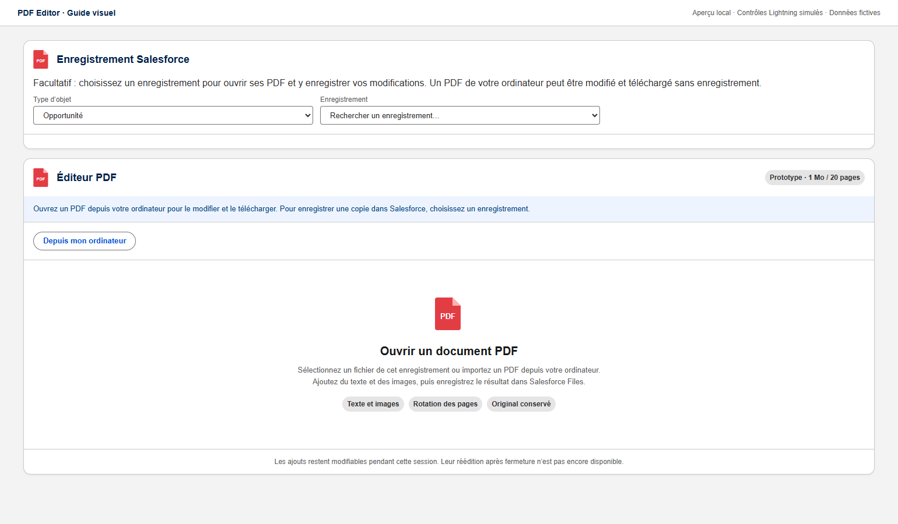
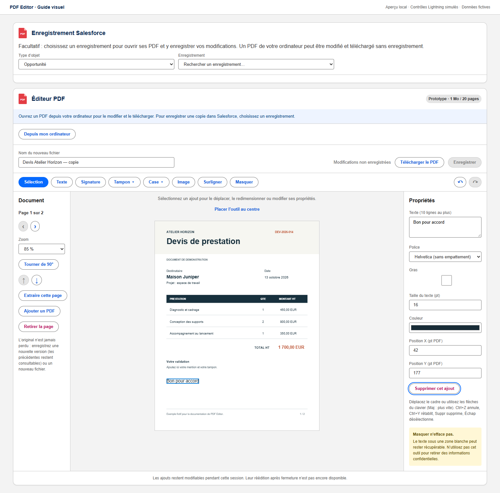
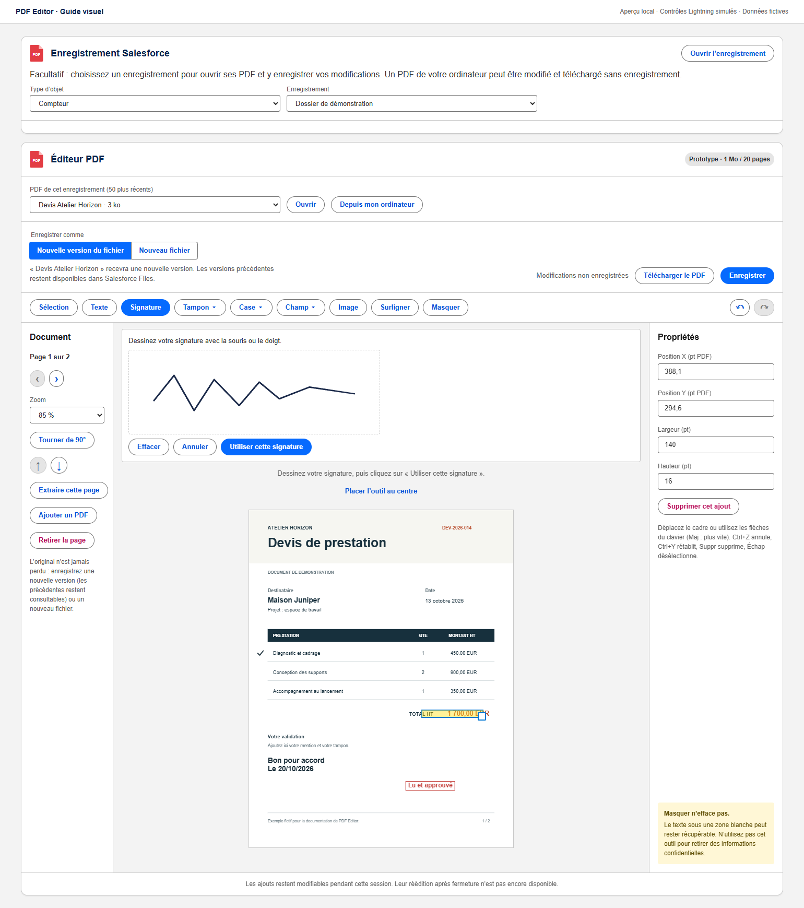
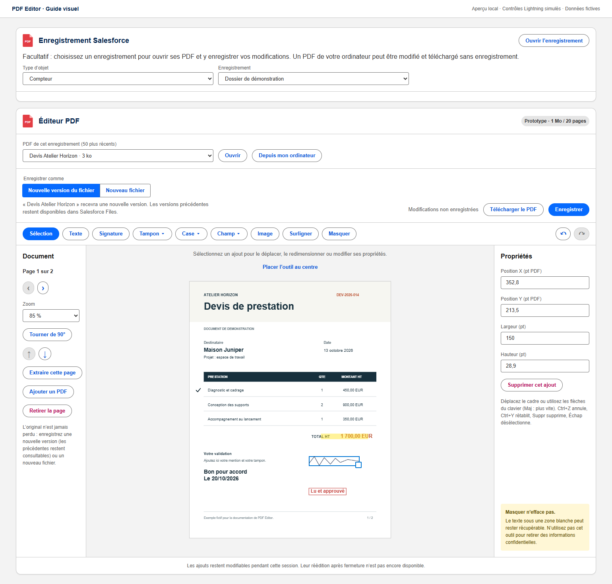
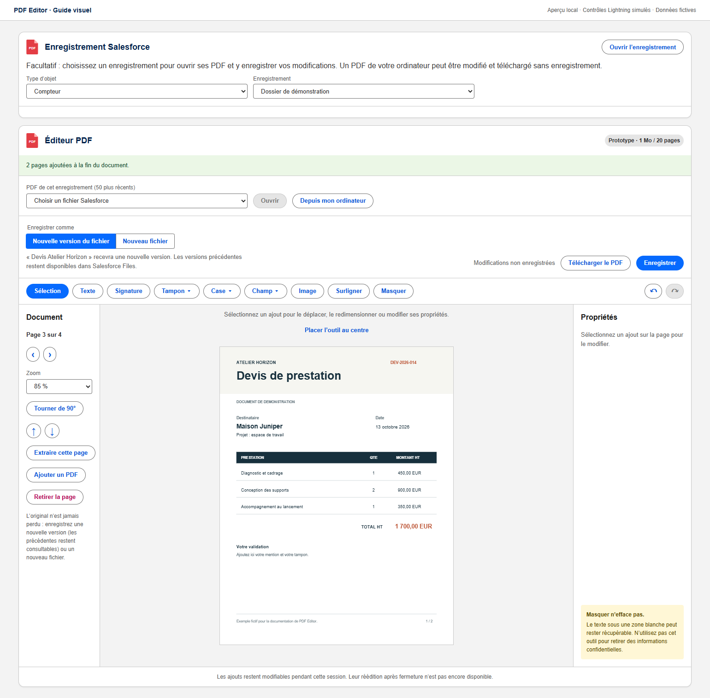
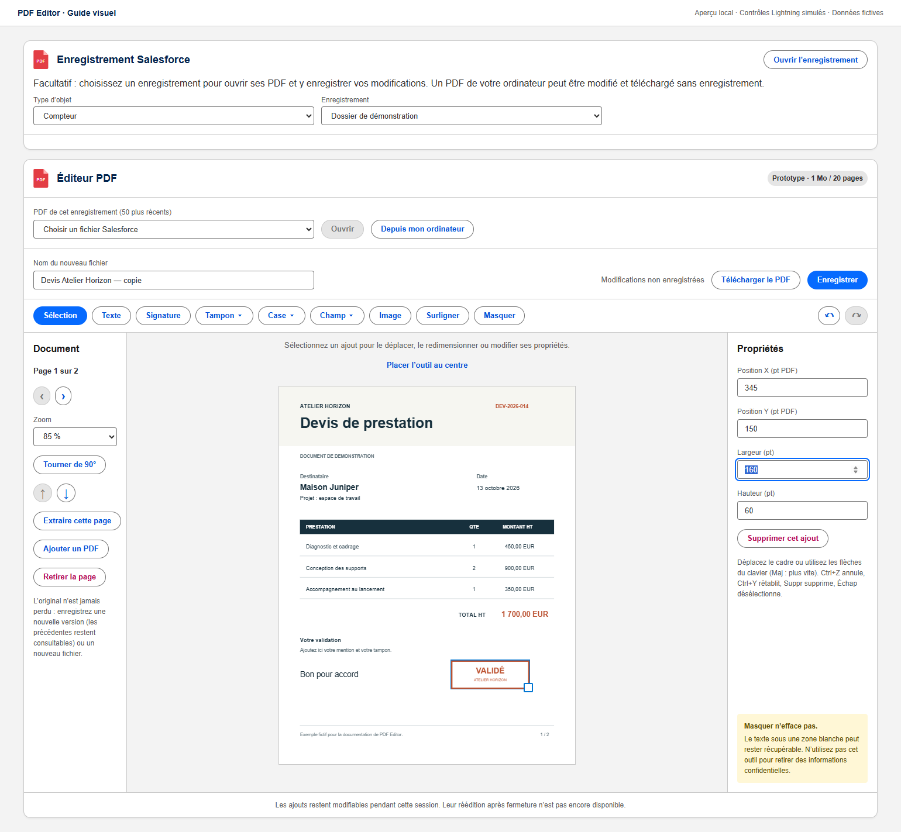
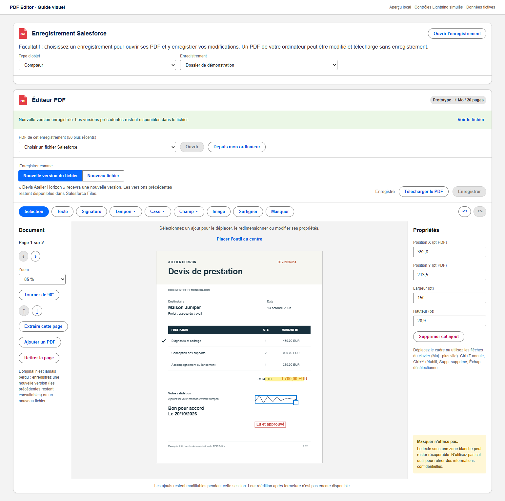

# PDF Editor

Prototype d’éditeur PDF en Lightning Web Component. Il permet de compléter un PDF depuis une opportunité (bouton **Modifier un PDF**), une page d’enregistrement ou une **page d’application dédiée**, puis de l’enregistrer dans Salesforce Files : **nouvelle version du fichier** par défaut, ou nouveau fichier.

**Prérequis : Lightning Web Security (LWS) activé.** Le moteur n’est pas compatible avec l’ancien Lightning Locker. Vérifier **Configuration → Paramètres de session → Utiliser Lightning Web Security** avant la recette. Ce réglage concerne toute l’organisation ; le bouton de déploiement ne le change pas. [Documentation Salesforce](https://developer.salesforce.com/docs/platform/lightning-components-security/guide/lws-enable.html).

## Ajouter l’éditeur à Capitole Énergie

Le projet fournit la page d’application **Éditeur PDF** (`PDF_Editor_App`) et son onglet Lightning **Éditeur PDF** (`PDF_Editor`). L’application Capitole Énergie existante n’est pas incluse ni modifiée par le déploiement.

1. Déployer le projet, puis attribuer le Permission Set **LovePdfSales — Éditeur PDF** (`PDF_Editor_User`) aux utilisateurs concernés. Il donne accès au contrôleur Apex et rend l’onglet visible ; les droits métier sur les enregistrements et fichiers restent nécessaires.
2. Dans **Configuration → Gestionnaire d’applications**, trouver **Capitole Énergie**, puis **Modifier**.
3. Ouvrir **Éléments de navigation**, ajouter **Éditeur PDF** aux éléments sélectionnés, choisir sa position et enregistrer.
4. Recharger Capitole Énergie et ouvrir l’onglet **Éditeur PDF**. Ouvrir directement un PDF avec **Depuis mon ordinateur**, ou choisir un **Type d’objet** (Opportunité par défaut) puis un **Enregistrement** : ses PDF s’affichent aussitôt.

### Ajouter le bouton « Modifier un PDF » aux opportunités

Le déploiement crée l’action **Modifier un PDF** (`Opportunity.Modifier_un_PDF`), sans l’ajouter aux présentations de page de l’organisation. Pour l’afficher :

1. **Configuration → Gestionnaire d’objets → Opportunité → Présentations de page**, ouvrir la présentation utilisée.
2. Dans la palette, choisir **Actions mobiles et Lightning**, puis glisser **Modifier un PDF** dans la section **Actions Salesforce Mobile et Lightning Experience**. Enregistrer.
3. Si la page Lightning de l’opportunité utilise les actions dynamiques, ajouter plutôt l’action dans **Lightning App Builder**, sur le panneau de mise en évidence.

Le bouton ouvre l’onglet **Éditeur PDF** en pleine largeur, déjà positionné sur l’opportunité, avec la liste de ses PDF. **Ouvrir l’enregistrement** ramène à l’opportunité.

La recherche permet de choisir l’objet directement dans la page : **opportunité (présélectionnée), compte, contact, offre/devis, contrat, commande, contrat de service, compteur et autres objets personnalisés éligibles**. Les libellés proviennent de Salesforce ; les choix tiennent compte des droits de lecture de l’utilisateur. Les objets personnalisés doivent disposer d’un champ `Name` lisible, et le [sélecteur d’enregistrements Lightning](https://developer.salesforce.com/docs/platform/lightning-component-reference/guide/lightning-record-picker) doit prendre en charge l’objet. Les objets de configuration et le journal interne sont exclus. Un objet non pris en charge affiche un message, sans bloquer l’ouverture locale.

Le choix d’un enregistrement est **facultatif pour modifier et télécharger un PDF local**. Il est nécessaire pour enregistrer dans Salesforce. Vous pouvez le choisir après avoir commencé l’édition : les modifications du PDF local sont conservées.

Choisir un autre enregistrement l’applique immédiatement. Si le PDF ouvert provient de Salesforce, il est fermé après confirmation des modifications non enregistrées ; il n’est jamais rattaché silencieusement à un autre enregistrement. En cas de refus, l’enregistrement précédent est conservé. Le changement est bloqué seulement pendant une ouverture, un téléchargement ou un enregistrement.

## Charte Salesforce et SLDS 2

L’interface utilise les composants natifs `lightning-card`, `lightning-button`, `lightning-button-icon`, `lightning-input`, `lightning-combobox`, `lightning-badge` et `lightning-icon`. Leur apparence est fournie par Salesforce, selon le thème de l’organisation. La police est héritée de la page ; aucune couleur de marque ni surcharge `--slds-c-*` n’est imposée aux contrôles.

Les panneaux, séparateurs et cadres de sélection du PDF consomment les **global styling hooks SLDS** (`--slds-g-*`) pour suivre les couleurs et espacements du thème. Des valeurs de repli permettent l’affichage lorsque ces hooks ne sont pas disponibles. Le document PDF conserve ses propres couleurs.

Pour obtenir l’apparence **SLDS 2**, l’organisation doit utiliser un thème compatible, notamment **Salesforce Cosmos**. Déployer le composant ne change pas le thème de l’organisation. Voir [la comparaison officielle des versions SLDS](https://developer.salesforce.com/docs/platform/lwc/guide/create-components-css-slds1-slds2.html) et [les recommandations Salesforce sur les global styling hooks](https://www.lightningdesignsystem.com/2e1ef8501/v/0/p/777f5a-global-styling-hooks).

## Comment ça fonctionne

Les captures suivantes montrent le **composant LWC réel et son moteur PDF dans un aperçu local**, avec un devis fictif. Les contrôles Lightning et les appels Salesforce sont simulés pour cette démonstration ; ce ne sont pas des captures d’une organisation de production. L’aspect exact des contrôles natifs, des icônes et de la typographie dépend du thème Salesforce et reste à vérifier dans votre organisation.

### 1. Ouvrir un PDF

Cliquer sur **Depuis mon ordinateur** pour sélectionner un PDF, sans choisir d’enregistrement au préalable. Pour un PDF déjà présent dans Salesforce, utiliser le bouton **Modifier un PDF** de l’opportunité, ou choisir l’objet et l’enregistrement dans l’onglet, puis choisir le fichier dans la liste et cliquer sur **Ouvrir**.



### 2. Ajouter et modifier du texte

Cliquer sur **Texte**, puis sur la page ou sur **Placer l’outil au centre**. Le panneau **Propriétés** permet de saisir la mention, régler sa taille et sa couleur, et ajuster sa position. Ici, « Bon pour accord » est ajouté au devis.



### 3. Signer, tamponner, cocher

**Signature** ouvre une zone de dessin : signer à la souris ou au doigt, puis **Utiliser cette signature** et cliquer sur la page. La signature reste disponible pendant la session (**Réutiliser ma signature**). Elle est ajoutée comme une image : ce n’est pas une signature électronique certifiée.



**Tampon** propose des mentions prêtes à l’emploi, encadrées en rouge : Bon pour accord, Lu et approuvé, Copie conforme, Payé, la date du jour, le nom de l’utilisateur connecté avec ou sans la date. Le texte d’un tampon reste modifiable. **Case** place une coche ✓ ou une croix ✗, **Surligner** une bande jaune translucide ; les deux se redimensionnent avec leur poignée. Le **Texte** accepte jusqu’à 10 lignes, en Helvetica, Times ou Courier, avec ou sans gras.



Raccourcis, hors des champs de saisie : **Ctrl+Z** annule, **Ctrl+Y** rétablit, **Suppr** supprime l’ajout sélectionné, **Échap** désélectionne et revient à l’outil Sélection. Le zoom **Ajuster à la largeur** est choisi par défaut.

### 4. Champs de l’enregistrement et pages

**Champ** (visible quand un enregistrement est choisi) liste les valeurs renseignées de l’enregistrement, mises en forme comme dans Salesforce : nom, montant avec sa devise, dates, listes de sélection traduites, et nom des enregistrements liés (par exemple le compte d’une opportunité). Choisir une valeur puis cliquer sur la page l’insère comme un texte modifiable. Seuls les champs lisibles par l’utilisateur sont proposés.

Dans le panneau **Document** : les flèches déplacent la page affichée, **Extraire cette page** télécharge cette page seule avec ses ajouts, **Ajouter un PDF** ajoute les pages d’un autre PDF de l’ordinateur à la fin (20 pages au total). Le tout est enregistré comme un seul document.



**Brouillon :** les modifications non enregistrées sont conservées dans ce navigateur, sur ce poste uniquement. En rouvrant le même fichier, l’éditeur propose **Reprendre le brouillon** ou **Ignorer**. Le brouillon est effacé après l’enregistrement et au bout de 7 jours. Un document auquel un autre PDF a été ajouté n’est pas conservé en brouillon.

### 5. Ajouter une image

Cliquer sur **Image**, sélectionner un PNG ou JPEG, puis le placer dans le document. Déplacer son cadre ou ajuster les coordonnées, la largeur et la hauteur dans **Propriétés**. L’exemple utilise un tampon fictif « VALIDÉ » et montre le choix d’un compteur comme destination après l’ouverture locale du PDF. Le cadre sélectionné se redimensionne avec sa poignée.



### 6. Enregistrer

Cliquer sur **Enregistrer**. Pour un PDF venant de Salesforce, **Nouvelle version du fichier** est choisi par défaut : le fichier garde son nom et ses versions précédentes restent consultables dans Salesforce Files. **Nouveau fichier** crée un document séparé, nommé librement et lié à l’enregistrement ; c’est le seul choix pour un PDF de l’ordinateur. **Télécharger le PDF** récupère le résultat sans rien enregistrer dans Salesforce. **Voir le fichier** ouvre l’aperçu. La capture ci-dessous illustre une **sauvegarde simulée localement** ; aucun fichier n’est envoyé à Salesforce par la démonstration.

Une nouvelle version est refusée si le fichier a reçu une autre version depuis son ouverture, ou si vous n’avez pas le droit de le modifier ; l’éditeur propose alors d’enregistrer un nouveau fichier, sans perdre vos modifications.



## Déployer en production

[](https://githubsfdeploy.herokuapp.com/?owner=Nounem&repo=pdf-editor-salesforce)

Le bouton ouvre **GitHub Salesforce Deploy Tool**, avec la cible **Production / Developer** sélectionnée par défaut. Le déploiement s’effectue dans l’organisation à laquelle vous vous connectez, après confirmation dans l’outil.

1. Publier ce projet dans [Nounem/pdf-editor-salesforce](https://github.com/Nounem/pdf-editor-salesforce) avec `sfdx-project.json` et `force-app` à la racine. Inclure la ressource compilée `force-app/main/default/staticresources/lovePdfEngine.resource` et toutes les métadonnées ; aucune compilation npm n’est effectuée par le bouton.
2. Cliquer sur le bouton : **Owner** (`Nounem`) et **Repository** (`pdf-editor-salesforce`) sont préremplis. Conserver **Production / Developer**, préciser éventuellement **Branch/Tag/Commit**, puis se connecter à l’organisation de production souhaitée.
3. Vérifier les composants proposés et lancer **Deploy**. Les exigences de tests Apex et de couverture de Salesforce restent applicables en production.
4. Après le déploiement, attribuer le Permission Set **LovePdfSales — Éditeur PDF** aux utilisateurs concernés, puis ajouter l’onglet à Capitole Énergie comme indiqué ci-dessus, ou placer le composant sur une page d’enregistrement dans Lightning App Builder.

**Source du déploiement :** le bouton utilise le dépôt [Nounem/pdf-editor-salesforce](https://github.com/Nounem/pdf-editor-salesforce). Les fichiers à déployer doivent y être publiés ; les modifications présentes uniquement sur votre ordinateur ne sont pas récupérées par le bouton.

L’outil est un service tiers qui demande une autorisation Salesforce pour déployer les métadonnées. Il prend en charge le répertoire par défaut des projets Salesforce DX. [Documentation de GitHub Salesforce Deploy Tool](https://github.com/afawcett/githubsfdeploy).

La validation actuelle porte sur le prototype en sandbox ; la recette de l’interface sous Lightning Web Security reste décrite dans [les résultats de validation](docs/VALIDATION_PROTOTYPE.md).

## Fonctionnalités développées

- Ouvrir un PDF lié à l’enregistrement ou un fichier local.
- Rechercher un enregistrement en choisissant son objet, y compris les objets personnalisés éligibles.
- Modifier puis télécharger un PDF local sans choisir d’enregistrement Salesforce.
- Choisir la destination Salesforce après l’édition d’un PDF local en conservant les ajouts.
- Ajouter du texte sur 10 lignes au plus, en 3 polices, gras ou non, et régler sa taille, sa couleur et sa position.
- Signer à la main, apposer un tampon prêt à l’emploi (date du jour, nom de l’utilisateur…), cocher ✓/✗ et surligner.
- Raccourcis Ctrl+Z, Ctrl+Y, Suppr et Échap ; zoom ajusté à la largeur.
- Insérer les valeurs de l’enregistrement (nom du compte, montant, dates…).
- Déplacer et extraire une page, ajouter les pages d’un autre PDF.
- Brouillon conservé sur le poste et proposé à la réouverture du fichier.
- Ajouter des images PNG/JPEG et régler leurs dimensions.
- Ajouter un rectangle blanc de **masquage visuel**.
- Sélectionner et déplacer les ajouts à la souris, au clavier ou avec leurs coordonnées.
- Supprimer un ajout, annuler/rétablir les 50 dernières commandes.
- Parcourir, tourner, déplacer, extraire et retirer des pages.
- Ouvrir l’éditeur depuis une opportunité avec le bouton **Modifier un PDF**.
- Enregistrer une **nouvelle version** du fichier (par défaut) ou un **nouveau fichier** lié à l’enregistrement, avec réessai idempotent.
- Redimensionner une image ou un masque à la souris.

La page d’origine est affichée une seule fois et les ajouts sont dessinés en direct par-dessus : déplacer, redimensionner ou modifier un ajout ne reconstruit pas le PDF. Le moteur PDF n’est chargé qu’à la première ouverture d’un PDF (il est préchargé au survol des boutons d’ouverture), pour ne pas ralentir les pages qui affichent l’éditeur. Le PDF final est fabriqué au téléchargement ou à l’enregistrement ; les ajouts y sont orientés comme à l’écran, y compris sur une page pivotée. Les bibliothèques sont embarquées en Static Resource : aucun service PDF externe ni CDN n’est utilisé.

## Limites du prototype

**1 000 000 octets** en entrée et en sortie, **20 pages**, **100 ajouts**. Images : 500 000 octets et 8 millions de pixels au maximum. Une image peut faire dépasser la limite de sortie.

- Le masquage blanc ne supprime pas les informations sous-jacentes. Il ne permet pas de caviarder des données confidentielles.
- Les PDF chiffrés, avec signature/champ de signature ou formulaires interactifs sont refusés avant édition.
- Les PDF contenant des liens ou des commentaires s’ouvrent, mais ces liens et commentaires ne sont pas repris dans la copie ; un message le signale à l’ouverture.
- Texte latin (Helvetica, Times ou Courier), 10 lignes de 200 caractères au maximum. La signature dessinée est une image, sans valeur de signature électronique. Pas d’édition du texte d’origine, d’OCR, de fusion ni de réorganisation des pages dans cette version.
- Les ajouts restent éditables pendant la session. Après fermeture, ils sont intégrés au contenu du PDF ; le projet d’édition n’est pas conservé.
- Le moteur PDF.js fonctionne dans le thread principal pour éviter les workers et imports dynamiques sous LWS. Cela reste à qualifier en interface Lightning dans l’org cible.
- Les messages internes du moteur sont copiés en JavaScript dans son contexte LWS, sans transfert de buffers ni modification des API globales. Les tests navigateur couvrent le moteur natif et la bibliothèque officielle de sandbox LWS ; la recette dans une page Lightning réelle reste nécessaire.
- Seuls les utilisateurs internes et Lightning Experience sur ordinateur sont ciblés. Les nouveaux fichiers sont liés à l’enregistrement avec une visibilité `InternalUsers`.
- Les grands fichiers, polices/CMaps particuliers, PDF/A et l’accessibilité du PDF produit restent hors garantie du prototype.

## Installer dans une sandbox

Les ressources compilées et les métadonnées sont déjà dans `force-app`. Le 13 octobre 2026, le projet a été déployé pour test dans la sandbox `optiTurpe`, avec ajout de l’onglet **Éditeur PDF** à **Capitole Énergie** et attribution du Permission Set à l’utilisateur de test. Les commandes ci-dessous permettent une installation dans une sandbox ; `--dry-run`, lorsqu’il est ajouté, valide seulement le déploiement.

Le diagnostic avait relevé `lockerServiceNext=false` dans cette sandbox. Après accord de l’administrateur, **LWS a été activé dans `optiTurpe` le 13 octobre 2026**, par un déploiement de configuration distinct. Le bouton GitHub ne modifie pas ce paramètre dans les autres organisations. Recharger la page, ou ouvrir une nouvelle session, après l’activation. Les messages distinguent une erreur de chargement du moteur d’une erreur de lecture des PDF, et proposent de réessayer.

La configuration propre à Capitole Énergie a été récupérée dans la sandbox pour y ajouter l’onglet en conservant ses réglages. Cette configuration reste locale et n’est pas incluse dans le dépôt générique : le bouton GitHub déploie l’App Page et son onglet ; l’ajout à la navigation d’une autre organisation suit les étapes en début de README.

```powershell
sf project deploy start --target-org optiTurpe --source-dir force-app --test-level RunSpecifiedTests --tests PdfEditorControllerTest --wait 10
sf org assign permset --target-org optiTurpe --name PDF_Editor_User
```

Dans Lightning App Builder, modifier une page d’enregistrement, placer **LovePdfSales — Éditeur PDF** dans une zone large, puis enregistrer/activer cette page pour les testeurs. L’identifiant de l’enregistrement est fourni automatiquement au composant.

Le Permission Set donne accès au contrôleur. Les utilisateurs doivent aussi disposer des droits habituels de lecture sur les enregistrements et de création/partage de fichiers. Le composant ne contourne pas ces droits. L’objet de suivi des requêtes est interne ; il n’est pas destiné à être modifié par les utilisateurs.

## Construire et tester

Node.js 22 récent ou ultérieur, npm, Salesforce CLI. Les tests navigateur utilisent Edge installé sur Windows.

```powershell
npm ci
npm run build
npm run check
npm test
npm run test:browser
sf project deploy start --dry-run --target-org optiTurpe --source-dir force-app --test-level RunSpecifiedTests --tests PdfEditorControllerTest --wait 10
```

- `build` assemble PDF.js et pdf-lib en une ressource statique d’environ 2,13 Mo et génère les notices de licence.
- `check` compile les sources LWC.
- `test` vérifie le modèle d’édition et l’interface avec les stubs Salesforce.
- `test:browser` exécute le vrai moteur PDF dans Edge avec une CSP qui interdit les workers et les scripts externes. Ces tests ne reproduisent pas Lightning Web Security.
- Les tests Apex vérifient lecture, nouveau fichier, nouvelle version (y compris le refus d’une source dépassée), réessai, rejets et accès à un fichier privé. Ils utilisent des fichiers minimaux pour les contrôles serveur ; les tests navigateur couvrent le parsing/export réel.

Pour régénérer les quatre captures à partir du composant et du moteur compilé : `npm run docs:screenshots`. Le script utilise Edge en mode sans interface, des données fictives et des adaptateurs locaux ; il n’appelle aucune organisation Salesforce.

## Organisation du code

| Fichier / dossier | Rôle |
|---|---|
| `force-app/main/default/lwc/pdfEditor/` | Interface et coordination des appels Salesforce |
| `force-app/main/default/lwc/pdfEditorApp/` | Sélection d’un enregistrement pour la page d’application |
| `force-app/main/default/lwc/pdfEditorAction/` et `quickActions/` | Bouton **Modifier un PDF** des opportunités |
| `force-app/main/default/flexipages/PDF_Editor_App.flexipage-meta.xml` | Page d’application Lightning de l’éditeur |
| `force-app/main/default/tabs/PDF_Editor.tab-meta.xml` | Onglet à ajouter à Capitole Énergie |
| `force-app/main/default/lwc/pdfEditState/` | État, commandes, historique, encodage binaire |
| `scripts/engine-entry.js` | Adaptateur PDF.js/pdf-lib et refus des formats hors périmètre |
| `force-app/main/default/classes/PdfEditorController.cls` | Contrôles d’accès et transactions Files |
| `force-app/main/default/objects/PDF_Edit_Operation__c/` | Suivi interne des requêtes idempotentes |
| `tests/` | Tests du modèle et du moteur navigateur |

Les requêtes et écritures Files sont en mode utilisateur. Seul le journal interne d’idempotence est accédé en mode système, avec une clé incluant l’utilisateur et un filtre sur l’auteur. Chaque restitution de fichier repasse par un contrôle d’accès en mode utilisateur. La création du fichier, son lien et la trace sont transactionnels.

## Étape suivante

Le détail des résultats exécutés est conservé dans [docs/VALIDATION_PROTOTYPE.md](docs/VALIDATION_PROTOTYPE.md).

Le parcours, les responsabilités et les règles de changement de destination sont modélisés dans [docs/PARCOURS_MULTI_OBJETS.md](docs/PARCOURS_MULTI_OBJETS.md).

Effectuer la recette **dans une page Lightning avec LWS activé**, notamment : chargement du bundle, ajout et déplacement, rendu des accents/images, copie et lecture par un utilisateur non administrateur, coupure réseau, déclencheurs de l’organisation et mesure du heap près du seuil de 1 Mo. Ne pas augmenter ce seuil sans mesure.

L’étude initiale et la modélisation restent disponibles dans [ETUDE_FAISABILITE_EDITEUR_PDF_LWC.md](ETUDE_FAISABILITE_EDITEUR_PDF_LWC.md). Les dépendances sont documentées dans [THIRD_PARTY_NOTICES.md](THIRD_PARTY_NOTICES.md).
