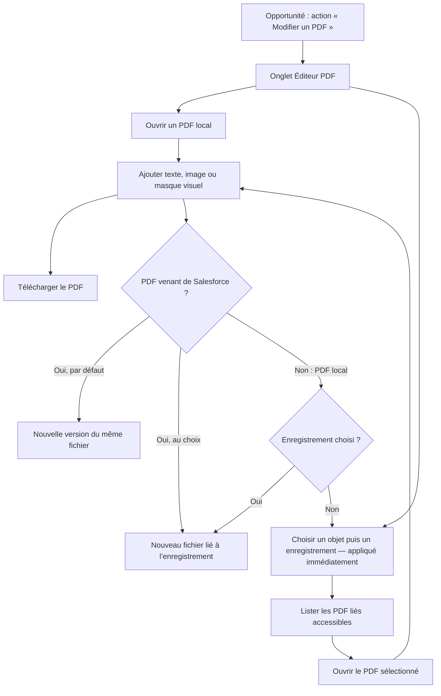

# Ouverture locale et recherche Salesforce

## Parcours

L’action « Modifier un PDF » ouvre l’onglet en pleine largeur avec l’enregistrement déjà choisi (paramètres d’URL `c__recordId` et `c__objectApiName`). Depuis l’onglet, l’Opportunité est présélectionnée ; un enregistrement choisi s’applique tout de suite, sans bouton de confirmation. Le choix d’un enregistrement n’est pas nécessaire pour ouvrir, modifier et télécharger un PDF local. Il devient obligatoire pour enregistrer dans Salesforce.

## Répartition des responsabilités

| Élément | Responsabilité |
|---|---|
| `pdfEditorAction` + action `Opportunity.Modifier_un_PDF` | Action d’enregistrement sans fenêtre : ouvre l’onglet sur l’enregistrement courant |
| `pdfEditorApp` | Objets proposés selon les droits, sélection native d’enregistrement appliquée immédiatement, retour à l’enregistrement |
| `pdfEditor` | PDF local ou lié, opérations d’édition, téléchargement, enregistrement en nouvelle version ou en nouveau fichier |
| `listRecordObjects` | Comptes, contacts, opportunités, prospects, devis, actifs, campagnes, produits, catalogues et objets personnalisés avec `Name` lisible ; exclusion des paramètres personnalisés et du journal interne |
| `listRecordPdfs` / `loadSmallPdf` | Lecture en mode utilisateur, vérification du lien à l’enregistrement et taille maximale |
| `saveNewVersion` | Nouvelle version du fichier source, refusée si une version plus récente existe ; idempotence |
| `saveCopy` | Nouveau document lié à l’enregistrement ; idempotence |
| `lovePdfEngine` | PDF.js et pdf-lib exécutés localement sous Lightning Web Security |

La recherche d’enregistrement dépend aussi de la prise en charge de l’objet par `lightning-record-picker`/UI API. Un échec sur un objet laisse le parcours local disponible.

## Règles de changement d’enregistrement

| État | Comportement |
|---|---|
| Aucun document | Appliquer l’enregistrement puis charger ses fichiers |
| PDF local ouvert | Garder le PDF et ses ajouts ; enregistrer sur le nouvel enregistrement |
| PDF Salesforce ouvert | Confirmer l’abandon des modifications si nécessaire, puis fermer le document ; aucun rattachement implicite. En cas de refus, l’enregistrement précédent est conservé |
| Recherche effacée ou changement d’objet | L’enregistrement actif reste inchangé |
| Traitement en cours (ouverture, téléchargement, enregistrement) | Refuser le changement jusqu’à sa fin |
| Échec de lecture des fichiers | Vider la liste précédente, afficher le contexte de l’erreur et proposer de réessayer |
| Échec du moteur | Expliquer le prérequis LWS et proposer de relancer le chargement ; le choix d’enregistrement reste possible |

## Règles d’enregistrement

| Source | Choix par défaut | Alternative |
|---|---|---|
| PDF Salesforce | Nouvelle version du même fichier (même nom, historique conservé) | Nouveau fichier, nommé par l’utilisateur |
| PDF local | Nouveau fichier lié à l’enregistrement choisi | Téléchargement seul |

Une nouvelle version est refusée si le fichier a reçu une autre version depuis son ouverture, ou si l’utilisateur n’a pas le droit de modifier ce fichier : l’éditeur propose alors d’enregistrer un nouveau fichier, sans perdre les modifications.

Les réponses de recherche devenues obsolètes après un changement d’enregistrement sont ignorées. Aucun document réel ni identifiant métier n’est utilisé dans les captures du README.

## Compatibilité du moteur

Le moteur fonctionne dans le thread principal. Le clonage natif des messages PDF.js peut perdre des propriétés lors d’un transfert de buffers à travers la membrane LWS ou rejeter des objets proxifiés. Le build injecte une fonction de clonage JavaScript dans le bundle PDF uniquement. Elle copie les messages et ignore les listes de transfert, sans remplacer `window.structuredClone`. Les workers, WebAssembly, OffscreenCanvas et ImageDecoder sont désactivés pour ce parcours.

La bibliothèque officielle `@locker/sandbox` est une dépendance de test uniquement. Les tests répètent ouverture, rendu, export avec texte et image, rotation et refus des PDF interactifs sous cette bibliothèque. Ils complètent la recette Salesforce, sans la remplacer.

La sandbox `optiTurpe` utilisait l’ancien Lightning Locker (`lockerServiceNext=false`) lors du diagnostic. Après accord explicite de l’administrateur, LWS a été activé le 13 octobre 2026 par un déploiement distinct. Cette activation concerne toute la sandbox. Les métadonnées génériques du projet n’incluent aucun changement de ces paramètres.
