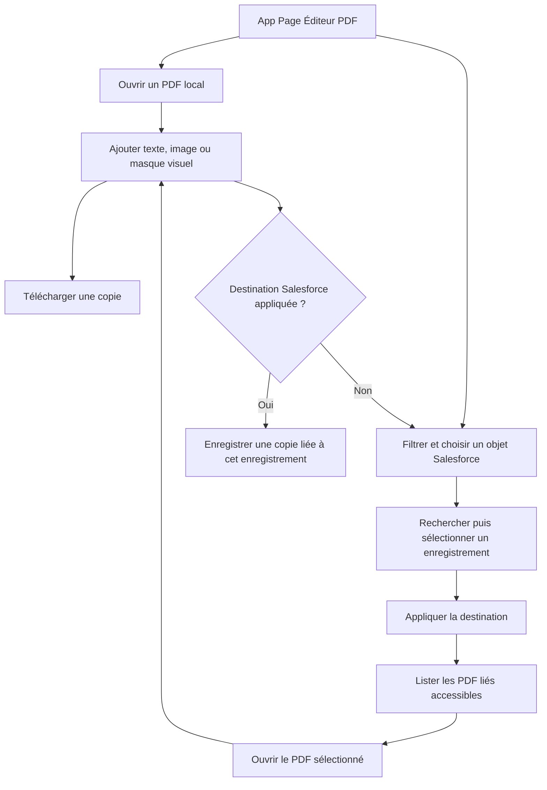

# Ouverture locale et recherche Salesforce

## Parcours

Le choix d’un enregistrement n’est pas nécessaire pour ouvrir, modifier et télécharger un PDF local. Il devient obligatoire pour enregistrer dans Salesforce. Les contrôles utilisent les composants Lightning natifs et les hooks du thème Salesforce.

## Répartition des responsabilités

| Élément | Responsabilité |
|---|---|
| `pdfEditorApp` | Objets proposés selon les droits, sélection native d’enregistrement, destination appliquée et changement confirmé |
| `pdfEditor` | PDF local ou lié, opérations d’édition, téléchargement et enregistrement d’une copie |
| `listRecordObjects` | Comptes, contacts, opportunités, prospects, devis, actifs, campagnes, produits, catalogues et objets personnalisés avec `Name` lisible ; exclusion des paramètres personnalisés et du journal interne |
| `listRecordPdfs` / `loadSmallPdf` | Lecture en mode utilisateur, vérification du lien à l’enregistrement et taille maximale |
| `saveCopy` | Contrôles d’accès, nouvelle version dans un nouveau document, lien et idempotence |
| `lovePdfEngine` | PDF.js et pdf-lib exécutés localement sous Lightning Web Security |

La recherche d’enregistrement dépend aussi de la prise en charge de l’objet par `lightning-record-picker`/UI API. Un échec sur un objet laisse le parcours local disponible.

## Règles de changement de destination

| État | Comportement |
|---|---|
| Aucun document | Appliquer la destination puis charger ses fichiers |
| PDF local ouvert | Garder le PDF et ses ajouts ; utiliser la destination appliquée pour la prochaine copie |
| PDF Salesforce ouvert | Confirmer l’abandon si nécessaire, fermer la source avant de changer ; aucun rattachement implicite |
| Nouvelle sélection non appliquée | Suspendre la sauvegarde Salesforce ; conserver l’édition locale |
| Traitement en cours | Refuser le changement jusqu’à sa fin |
| Échec de lecture des fichiers | Vider la liste précédente, afficher le contexte de l’erreur et proposer de réessayer |
| Échec du moteur | Expliquer le prérequis LWS et proposer de relancer le chargement |

Les réponses de recherche devenues obsolètes après un changement d’enregistrement sont ignorées. Aucun document réel ni identifiant métier n’est utilisé dans les captures du README.

## Compatibilité du moteur

Le moteur fonctionne dans le thread principal. Le clonage natif des messages PDF.js peut perdre des propriétés lors d’un transfert de buffers à travers la membrane LWS ou rejeter des objets proxifiés. Le build injecte une fonction de clonage JavaScript dans le bundle PDF uniquement. Elle copie les messages et ignore les listes de transfert, sans remplacer `window.structuredClone`. Les workers, WebAssembly, OffscreenCanvas et ImageDecoder sont désactivés pour ce parcours.

La bibliothèque officielle `@locker/sandbox` est une dépendance de test uniquement. Les tests répètent ouverture, rendu, export avec texte et image, rotation et refus des PDF interactifs sous cette bibliothèque. Ils complètent la recette Salesforce, sans la remplacer.

La sandbox `optiTurpe` utilisait l’ancien Lightning Locker (`lockerServiceNext=false`) lors du diagnostic. Après accord explicite de l’administrateur, LWS a été activé le 13 octobre 2026 par un déploiement distinct. Cette activation concerne toute la sandbox. Les métadonnées génériques du projet n’incluent aucun changement de ces paramètres.
